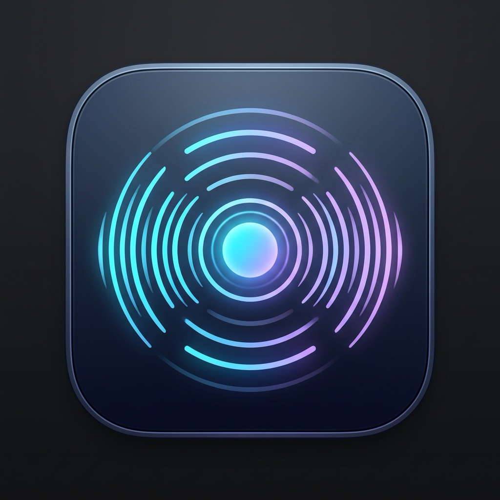
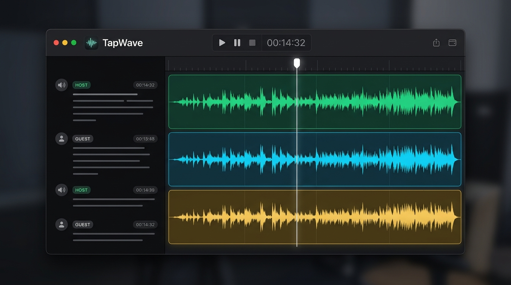
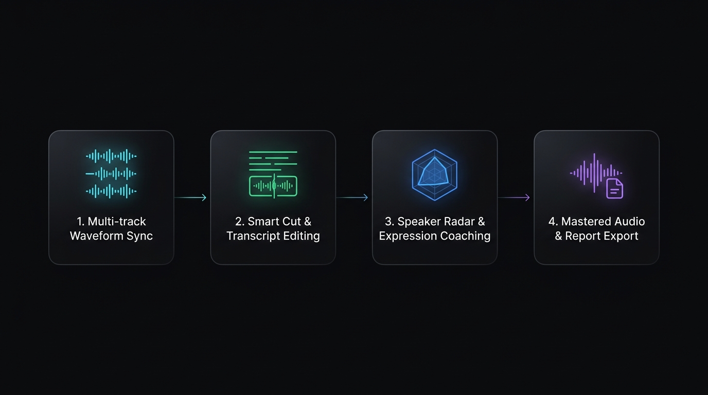
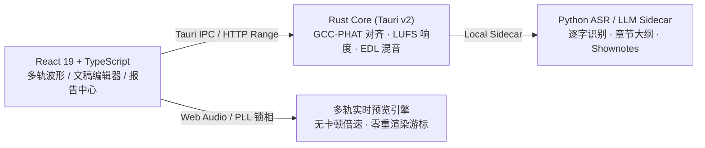

<div align="center">
  
  <h1>点波 TapWave · PodCraft Studio Pro (v2.2.1)</h1>
  <p><strong>专为 macOS 打造的多轨 AI 播客精剪、表达教练与全渠道内容衍生桌面工作站</strong></p>
  <p>
    
    
    
    
  </p>
  <p>
    <a href="#核心能力">核心能力</a> ·
    <a href="#工作流程">工作流程</a> ·
    <a href="#快速开始">快速开始</a> ·
    <a href="#技术架构">技术架构</a> ·
    <a href="#打包与发布">打包与发布</a> ·
    <a href="CHANGELOG.md">版本迭代记录 (CHANGELOG)</a>
  </p>
</div>

<p align="center">
  
</p>

---

**点波 TapWave** 是一款面向播客创作者与剪辑师的桌面级生产力工具，基于 **Tauri v2 + Rust 多轨 DSP 音频引擎 + React 19 + Python 本地/云端 ASR Sidecar** 构建。它将「文稿精读」与「多轨波形精剪」打通为同一套时间轴，帮助创作者以最低心智负担完成从多轨对齐、口癖气口精剪、表达复盘到成品母带导出的全链路制作。

---

## 核心能力

| 模块 | 能力亮点 |
| :--- | :--- |
| **🎙️ 双模式多轨同步** | 支持 **同屋录制模式**（`0ms` 免校准秒速建轨 + 跨轨串音门限抑制）与 **多设备校准模式**（基于 Rust `rustfft` GCC-PHAT 算法实现毫秒级对齐）。 |
| **✂️ 文稿 × 波形双向精剪** | 支持时间对话流 / 按发言人聚合审删；可在多轨波形直接框选执行「全轨波纹切除（含亚字级边界修剪）」「单轨局部静音」或「哔声消音」。 |
| **🔍 剪辑可追溯与撤销** | 点击波形上的任意 `✂️ 剪辑` 胶囊即可查看去掉的空白/文字与剪辑依据，并支持单点试听衔接与一键撤销；提供统一的**剪辑总览与报告中心**。 |
| **🧠 脱敏剪辑习惯学习** | 支持一键导出**剪辑分析报告长图（PNG）**与**脱敏剪辑习惯配置文件（`.podcraft-style.json`）**——不含任何对话原文、姓名或路径隐私，仅保留剪辑依据与参数，供客户端加载复用自动化剪辑风格。 |
| **📊 嘉宾表达教练与 Shownotes** | 绘制全片声学情绪能量曲线、拆解五维语言习惯健康度雷达图与主客问答比，输出嘉宾表达建议，并自动生成摘要、大纲时间轴与 Shownotes。 |
| **🎛️ 广播级混音与工程导出** | 支持 `-16.0 LUFS / -1.0 dBTP` 分轨响度对齐、片头高光/口播/片尾 BGM 自动闪避（Auto-Ducking），以及标准化 MP3/WAV 母带与 Reaper (`.rpp`) 多轨工程导出。 |

---

## 工作流程

<p align="center">
  
</p>

1. **多轨导入与对齐**：拖入单轨或多轨音频，自动完成响度扫描、静音检测与参考轨时间差校准。
2. **AI 偏好精剪与手动微调**：按个人呼吸感预设一键清理孤立口癖、重说口吃与冗余长停顿，并保护「嗯/对/啊」等自然捧场词；随时点击任意剪辑处查看依据或撤销。
3. **表达诊断与报告导出**：查看主持人与嘉宾五维表达雷达与建议，导出分析长图发给嘉宾复盘，或沉淀脱敏风格配置文件用于后续期数自动精剪。
4. **母带混音与全渠道分发**：叠加片头金句与片尾 BGM，一键导出标准化 MP3/WAV 母带、Reaper 工程与 Shownotes。

---

## 快速开始

### 环境要求

- **操作系统**：macOS（推荐 Apple Silicon `arm64`）
- **前端与桌面构建**：Node.js 20+、Rust 工具链（`cargo`）
- **本地语音识别（可选）**：Python 3.10+ / `uv`

### 本地开发与测试

```bash
# 1. 安装前端依赖
npm install

# 2. 运行前端单元测试与构建检查
npm test
npm run build

# 3. 启动浏览器开发预览 (http://localhost:1420)
npm run dev

# 4. 启动 macOS 原生 Tauri v2 桌面端
npm run tauri dev

# 5. 运行 Rust 音频 DSP 引擎测试
cd src-tauri && cargo test

# 6. (可选) 安装 Apple Silicon 本地逐字语音识别 Sidecar 依赖
uv pip install -r sidecar/requirements.txt
```

---

## 技术架构



### 目录结构速览

```text
podcraft-studio/
├── src/
│   ├── components/       # 多轨波形、文稿视图、AI 教练、剪辑详情浮窗与报告中心 UI
│   ├── engine/           # 时间轴 EDL、多轨音频预览、剪辑分析与海报渲染引擎
│   ├── data/             # 空工程模板与个人剪辑偏好预设
│   └── __tests__/        # Vitest 单元测试套件
├── src-tauri/            # Tauri v2 原生后端与 Rust 多轨音频 DSP 引擎
├── sidecar/              # Python 本地 ASR 与智能分析 Sidecar
├── docs/                 # 设计文档、策略配置与 README 配图资源
├── scripts/              # 自动化版本升级与 DMG 打包脚本
├── CHANGELOG.md          # 完整版本迭代记录
└── README.md             # 项目概览文档（本文档）
```

---

## 打包与发布

项目内置全自动化打包流水线，支持语义化升级版本号、同步更新 `package.json` / `tauri.conf.json` / `Cargo.toml`、将迭代概要自动归档至 [CHANGELOG.md](CHANGELOG.md)，并生成 DMG 与 ZIP 安装包覆盖输出至 `application/` 目录：

```bash
# 递增 patch 版本号 (例如 2.2.1 -> 2.2.2) 并打包
npm run package -- "本次更新说明"

# 递增 minor / major 版本号并打包
npm run package:minor -- "新增功能说明"
npm run package:major -- "架构升级说明"

# 不升级版本号直接重新打包
npm run package:no-bump -- "重新打包安装包"

# 或直接运行打包脚本
./build_perfect_package.sh "更新说明"
```

---

## 版本迭代记录

所有历史版本的详细更新日志已独立维护在 👉 **[CHANGELOG.md](CHANGELOG.md)**。
