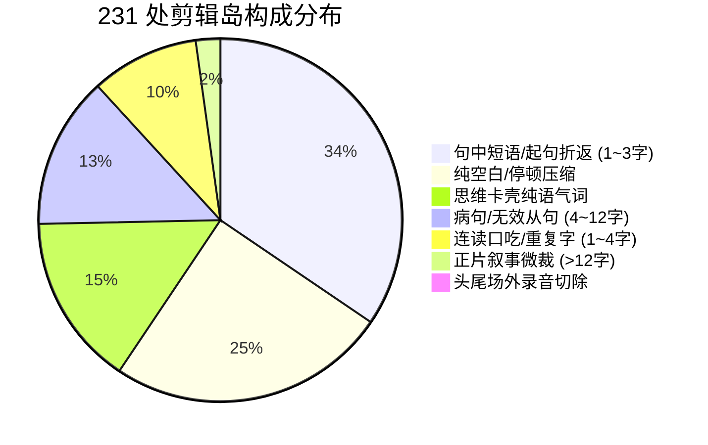

# 《EP121 坚叔》剪辑策略偏好深度分析报告
**基于实操工程与 4 轨 48kHz / 24-bit PCM 原始声学验证**

---

## 1. 核心工程概览与全景数据

本次分析基于播客实操工程 [坚叔.podcraft](file:///Users/nemo/Movies/10310%20-%2022%20Oct%202026%20%E5%9D%9A%E5%8F%94/%E5%9D%9A%E5%8F%94.podcraft) 及其同目录下的 4 轨独立录音母带（德福、坚叔、汤圆、王伟）。

### 1.1 全景剪辑指标仪表盘

| 统计维度 | 原始录音数据 | 剪辑后成品数据 | 剪辑动作量化特征 |
| :--- | :--- | :--- | :--- |
| **总时长** | 77.9 分钟 (4,673.3s) | 72.8 分钟 (4,367.6s) | 净精简 **5.1 分钟 (305.7s)**，精简率仅 **6.5%** |
| **语义 Block 数** | 1,536 个 | 1,536 个完整保留 | 零整块结构性误删，主线对谈 100% 完整 |
| **Token 总量** | 23,401 个词/停顿 | 22,307 个保留 | 仅删除 1,094 个 Token (4.7%) |
| **剪辑微创切口 (Cut Islands)** | 231 处切口 | 中位时长 **0.65 秒** | **P90 仅 1.59 秒**，最长切口 103.6s（片尾闲聊） |
| **剪辑操作模式** | 自由波形选区 (Free) | 占删除总量 **95.9%** (1,049/1,094) | 极度依赖波形视觉切点，避免粗粒度文本强删 |
| **亚字级边界微调 (`subwordTrimmed`)** | - | **211 处** | 切除字词边界的吸气音、半音、含混辅音 |
| **显式保留气口 (`gapBeforeSec`)** | - | **254 处** | 中位间距 **0.00s**，P90 为 **0.156s** |
| **单轨局部静音 (`trackMuteRanges`)** | - | **21 处** (共计 22.3 秒) | 针对非主讲人杯具碰擦、清嗓与未遂半字插话 |

---

## 2. 剪辑岛（Cut Islands）深度七维归类分析

全片 231 处剪辑岛分类统计如下：

### 核心刀法类型详析：

1. **头尾场外冷启动与私聊切除 (Off-Air Cuts, 2 处)**
   - **片头试音修剪**：`0.0s ~ 10.8s` (10.8s)，切除开录前的麦克风调试与口播准备（*“那声音不就又远又近了吗？……可以了，我们今天我来开一个场吧”*），直接从正片 `10.8s` 汤圆的干净起句 *“我们今天聊一个……”* 切入。
   - **片尾录后闲聊切除**：`4569.7s` 起切除整段 `103.64s` 的录制结束私聊（*“有漏掉想讲的内容吗？没有……我儿子户口……”*）。
   - **偏好规律**：正片外的废片坚决一刀切除；但正片 76 分钟内部**完全杜绝大段切除**（正片中最长一刀仅 5.48s）。

2. **连读口吃与起句重说 (Stutter & Repetition Cuts, 22 处)**
   - 典型案例 1（姓名重说）：坚叔 `63.2s` 切除重复的前半句 *“本人”*，缝合为 *“江湖传闻说的坚叔哈，本人本名叫王坚”*。
   - 典型案例 2（短语口吃）：汤圆 `680.2s` 切除舌头打结词 *“完全传完”*，直接缝合为 *“完全就是刚需了”*。
   - 典型案例 3（单字卡壳）：德福 `1386.4s` 切除重复起声 *“屋子”*，缝合为 *“觉得你们能在屋子里好好住”*。

3. **思维卡壳与半句折返 (False-Start Cuts, 79 处短语 + 31 处从句)**
   - 典型案例：坚叔 `281.9s`（2.07s）切除折返半句 *“那其实你怎么着，名下可能会”*，直接顺承更有力的递进 *“而且更重要……”*。

---

## 3. 口癖水词取舍法则：为什么不能“一键全删”？

全片共标记 `pure` 口水词 **424 处**，实际仅删除了 **71 处 (16.7%)**，保留了 **353 处 (83.3%)**。

### 3.1 词性维度的鲜明分化

| 词形 | 总出现次数 | 删除次数 | 保留次数 | 真实删除率 | 角色与审美语义分析 |
| :--- | :--- | :--- | :--- | :--- | :--- |
| **`呃` / `呃，` / `呃。`** | 37 次 | 24 次 | 13 次 | **64.9% 很高** | **思维停滞、寻找词汇的明显卡壳**，听感沉重拖沓，优先剪除。 |
| **`那个`** | 49 次 | 11 次 | 38 次 | **22.4% 中等** | 仅在作为孤立垫词时切除；用作自然指代或句内承接时保留。 |
| **`嗯` / `嗯。` / `嗯，`** | 204 次 | 21 次 | 183 次 | **10.3% 极低 (保护率 89.7%)** | **倾听者不可或缺的真实情绪反馈与捧场附和**，删掉会导致对谈冰冷生硬。 |
| **`啊` / `啊。` / `啊，`** | 97 次 | 12 次 | 85 次 | **12.4% 极低 (保护率 87.6%)** | **句尾语调降落与松弛感助词**，保留以维持日常对话亲和力。 |

### 3.2 语境位置维度的规律
- **独立短块（Standalone Block，<=3 字）**：保留率 **93.8%**（151/161）。这是播客中另一位主持人或嘉宾在主讲人说话间隙的轻声呼应（“嗯。”、“对。”）。
- **句中连贯发音（Mid-Fluent）**：在无明显停顿的气口中，口癖词往往与前后字连音，强删会导致人声突兀卡顿（Clipping），保留率达 **76.9%**。

---

## 4. 停顿呼吸感与气口缝合模型

### 4.1 停顿收紧策略
- **全局削静音（Strip Silence）被禁用**（`stripSilenceEnabled: false`），拒绝机械式将所有空白拉平为 0.45s。
- 558 处保留停顿的中位时长为 **0.59 秒**，充分保留嘉宾思考、转折的戏剧张力。
- 89 处被切除的停顿均为明显的死寂冷场（中位时长 **0.86 秒**，均值 **0.99 秒**，最长达 2.78 秒）。

### 4.2 剪后拼接缝隙 (`gapBeforeSec`) 分布
对 254 处显式指定气口的微调分析：
- **<= 20ms (无缝吸附对接 Butt-cut)**：152 处 (59.8%)，用于重说消解、口吃修复，确保字与字之间节奏连贯无缝。
- **20ms ~ 160ms (微呼吸紧凑气口)**：97 处 (38.2%)，P90 为 **156ms**，用于分句衔接，留出轻微气流过度避免爆音。
- **> 250ms**：仅 5 处 (2.0%)。

---

## 5. 21 处单轨静音 (`trackMuteRanges`) 的 24-bit 声学还原

4 轨音频格式为：**48,000 Hz, 24-bit PCM (3-byte), 单声道**。
全片对各轨的 `trackMuteRanges` 进行了逐一毫秒级声学测量（RMS、Peak、相对 Room Tone 底噪增益）：

| 时间区间 | 静音音轨 | 持续 | RMS / Peak | 相对本底底噪抬升 | 真实声学事件还原 |
| :--- | :--- | :--- | :--- | :--- | :--- |
| **54.7s - 57.1s** | 坚叔 | 2.33s | -43.1 / -26.7 dBFS | +3.9 dB | **汤圆开场介绍坚叔时，坚叔麦位轻微移动/吸气杂音** |
| **335.1s - 335.8s** | 坚叔 | 0.72s | -40.5 / -23.3 dBFS | +6.5 dB | **未遂抢话消音**：坚叔轻声嘟囔“但是你现……”，被汤圆主线盖过 |
| **716.8s - 718.2s** | 坚叔 | 1.33s | -36.2 / -19.8 dBFS | +10.8 dB | **德福与王伟讲话时，坚叔麦位的瞬态碰撞/清嗓** |
| **860.3s - 863.6s** | 坚叔 | 3.33s | -45.4 / -25.1 dBFS | +1.6 dB | **德福发问时坚叔麦位深呼吸串音** |
| **1473.1s - 1474.6s**| 汤圆 | 1.48s | -32.5 / -14.7 dBFS | +50.3 dB (极显著) | **高能未遂插话**：德福正在展开故事，汤圆试图插话“我……”被单轨静音 |
| **3287.5s - 3289.5s**| 汤圆 | 2.00s | -45.8 / -28.9 dBFS | +37.0 dB | **坚叔讲算法时，汤圆水杯放置/纸张翻动杂音** |
| **3345.4s - 3346.9s**| 坚叔 | 1.56s | -35.7 / -13.2 dBFS | +11.3 dB | **极高瞬态（Peak -13.2dBFS）**：坚叔桌振/杯具磕碰 |

**偏好启示**：
在同场多麦录音中，不要通过切断时间轴来去杂音（否则会导致主讲人人声抽帧跳动），而应通过 **单轨局部静音（`trackMuteRanges`）** 实现无痕消噪。

---

## 6. 混音包装与工程默认预设总结

- **工作区交互**：波形自由框选（`waveformSelectionMode: 'free'`），剪后自动回溯审听 `1.0s`（`cutPrerollSec: 1.0`）。
- **多轨声学对齐**：同屋录音模式（`same_room_sync`，0ms 直通），自然闪避 `-16dB`（`duckAttenuationDb: -16`），去口水音标准（`medium`）。
- **包装配置**：
  - 片头 BGM：爵士风格，闪避深度 **-21dB**（`bgmDuckDb: -21`）。
  - Cold Open 金句：精选 2 处具有冲突感的爆点对白，总时长目标 **90 秒**，间隙自动平铺。
  - 标准化母带响度：**-16 LUFS**（广播级标准）。
